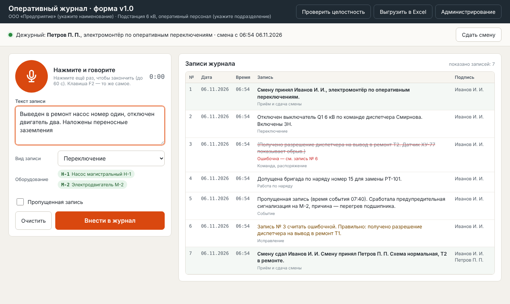

# Оперативный журнал с голосовым вводом — прототип

Программа для ведения оперативного журнала: дежурный диктует запись голосом, программа распознаёт речь **на своём компьютере, без интернета**, приводит текст к обозначениям из справочника оборудования и следит, чтобы журнал вёлся по правилам. Выгрузка — в Excel по графам утверждённой формы.



## Что умеет

- **Голосовой ввод.** Нажал кнопку (или F2), сказал «отключен выключатель ку один, включены заземляющие ножи» — получил «Отключен выключатель Q1. Включены ЗН.» Можно диктовать частями.
- **Справочник оборудования.** «Ку один» → Q1, «пэ тэ сто один» → PT-101. Неизвестные обозначения подсвечиваются предупреждением.
- **Перечень сокращений** предприятия: «заземляющие ножи» → ЗН, «киловольт» → кВ.
- **Вид записи** определяется сам: переключение, команда, работа по наряду (с номером наряда), событие.
- **Правила журнала встроены в программу:**
  - без принятой смены записи вносить нельзя;
  - дата и время ставятся автоматически, сквозная нумерация без пропусков;
  - записи нельзя изменить или удалить — запрет на уровне базы данных;
  - исправление — новая запись «Запись № N считать ошибочной. Правильно: …», ошибочная остаётся читаемой и зачёркнутой;
  - пропущенная запись — только с пометкой и временем события;
  - сдача смены — одна запись с подписями сдающего и принимающего (по ПИН).
- **Контроль целостности.** Каждая запись связана с предыдущей хэшем. Если кто-то поправит базу в обход программы, кнопка «Проверить целостность» покажет, какая запись подделана.
- **Excel по форме**, готовый к печати: шапка, графы шаблона, ошибочные записи в скобках и зачёркнуты, отметка о проверке целостности.
- **Администрирование** (`/admin`):
  - реестр нормативных документов-оснований и кнопка **«Проверить»**: программа скачивает документ, сравнивает с принятой редакцией и показывает изменённые абзацы. ИИ для этого не нужен. Новую редакцию принимает человек;
  - шаблоны форм с версиями и датой действия, предупреждение, если файл формы изменили без смены версии;
  - работники и ПИН, резервные копии базы, журнал действий администратора (тоже неизменяемый).

## Установка на Windows

1. Установите **Python 3.12** с [python.org](https://www.python.org/downloads/). В установщике отметьте **Add python.exe to PATH**.
2. Распакуйте архив в любую папку, например `C:\OperJournal`.
3. Дважды щёлкните **`start.bat`**. Первый запуск ставит компоненты (несколько минут, нужен интернет).
4. Браузер откроется сам на `http://localhost:8000`. При первом нажатии микрофона браузер спросит разрешение — разрешите.

При первом запуске программа скачивает модель распознавания речи (`small` — около 0,5 ГБ). Пока она скачивается, кнопка микрофона серая, а текст можно вводить с клавиатуры.

### Демонстрационные работники

| Работник | Роль | ПИН |
|---|---|---|
| Иванов И. И. | дежурный | 1111 |
| Петров П. П. | дежурный | 2222 |
| Сидоров С. С. | администратор (ответственный за электрохозяйство) | 0000 |

Смените ПИН и добавьте своих работников в разделе «Администрирование».

## Как пользоваться

1. **Принять смену** — выбрать себя и ввести ПИН.
2. Нажать **микрофон** (или F2), продиктовать, нажать ещё раз. Проверить текст, вид записи и найденное оборудование.
3. **Внести в журнал** (или Ctrl+Enter).
4. Ошиблись — кнопка **«Ошибочна»** у записи своей смены, продиктовать правильный вариант.
5. В конце смены — **«Сдать смену»**: ПИН сдающего и принимающего, замечания по состоянию оборудования.

## Настройка под своё предприятие

| Файл | Что в нём |
|---|---|
| `config.json` | наименование предприятия и подразделения, движок и размер модели распознавания |
| `data/templates/oper_journal.json` | графы формы, реквизиты приказа, документы-основания. **При любом изменении повышайте `version` и `effective_from`** — старые записи останутся в своей версии |
| `data/equipment.csv` | справочник: позиция; наименование; как её произносят (варианты через `\|`). Открывается в Excel |
| `data/abbreviations.json` | перечень сокращений. Сейчас там **пример** — замените на утверждённый у вас |
| `data/normative_docs.json` | начальный список документов-оснований. Ссылки удобнее менять в админке |

Сейчас в шаблоне — **типовая форма для демонстрации**. Форма оперативного журнала утверждается на предприятии, поэтому перенесите в шаблон графы вашей утверждённой формы.

## Распознавание речи

По умолчанию — **faster-whisper** (ставится сам, ffmpeg не нужен). Размер модели — `asr.whisper_model` в `config.json`:

| Модель | Размер | Качество | Скорость на обычном ПК |
|---|---|---|---|
| `small` | ~0,5 ГБ | хорошее | быстро |
| `medium` | ~1,5 ГБ | лучше | медленнее |
| `large-v3-turbo` | ~1,6 ГБ | лучшее из Whisper | нужен мощный ПК или видеокарта |

**GigaAM** (Сбер, сильнее на русском):
1. Установите [ffmpeg](https://ffmpeg.org/download.html) и добавьте его в PATH.
2. Установите [Git](https://git-scm.com/download/win), затем выполните в папке программы: `.venv\Scripts\python.exe -m pip install "gigaam[torch] @ git+https://github.com/salute-developers/GigaAM"`
3. В `config.json` укажите `"engine": "gigaam"`. Одна фраза — до 25 секунд, запись остановится сама.

`"engine": "none"` выключает голосовой ввод.

### Компьютер без интернета

Запустите программу один раз на компьютере с интернетом — модель скачается в папку `%USERPROFILE%\.cache\huggingface`. Перенесите папку программы вместе с `.venv` и эту папку кэша на компьютер без интернета.

Для проверки редакций документов без интернета сохраните страницу документа на другом компьютере и укажите в админке путь к файлу (`C:\Документы\pravila.html`).

## Ограничения прототипа

- **ПИН — не электронная подпись.** Чтобы журнал в электронном виде имел юридическую силу, нужны электронная подпись работников и решение предприятия о ведении журнала в электронном виде (п. 4 Требований, утв. приказом Минэнерго России от 01.09.2022 № 894). Это следующий этап.
- **Микрофон работает только по адресу `localhost`.** С планшета по сети браузер не даст доступ к микрофону без HTTPS — это следующий этап.
- Цепочка хэшей показывает правку записей, но удаление последних записей вместе с базой надёжнее ловить по резервным копиям. Делайте копии регулярно.
- Высота строк в Excel подбирается приблизительно — перед печатью посмотрите предпросмотр.

## Для разработчика

```
app/main.py         веб-сервер и API (FastAPI)
app/db.py           база SQLite: правила журнала, смены, цепочка хэшей, аудит
app/parser.py       разбор текста: справочник, сокращения, вид записи, наряды
app/asr.py          распознавание речи: faster-whisper, GigaAM
app/normcheck.py    проверка редакций документов (скачать, сравнить, показать изменения)
app/export_xlsx.py  выгрузка в Excel по шаблону
static/             интерфейс (HTML, CSS, JS без внешних библиотек — работает без интернета)
tests/              автотесты правил журнала
```

Тесты: `.venv\Scripts\python.exe -m pip install pytest`, затем `.venv\Scripts\python.exe -m pytest`.
